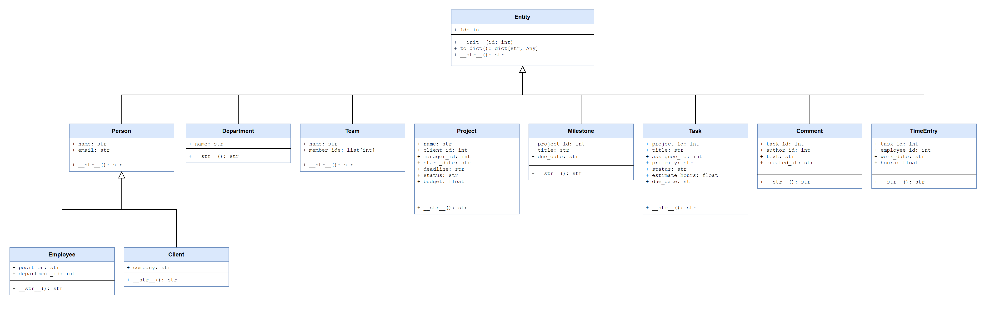
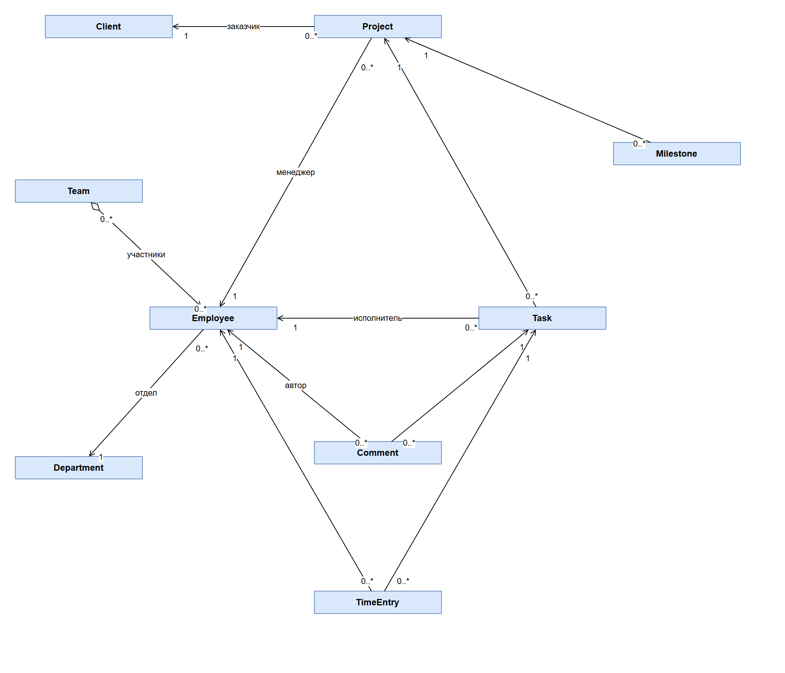
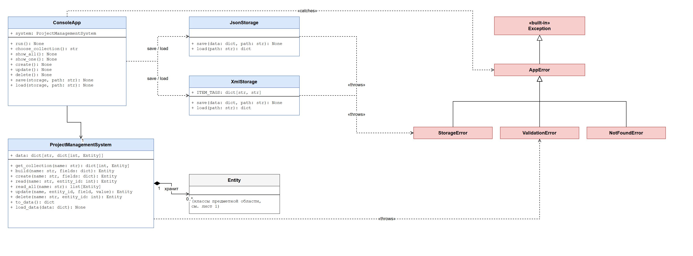

# ЛР №1. ООП в Python. Обработка исключительных ситуаций. Форматы XML и JSON

**Вариант 24 — «Управление проектами».**

## Описание

Консольная программа для учёта работы над проектами в компании. Она хранит
отделы, сотрудников, клиентов, команды, проекты, вехи, задачи, комментарии
и записи о затраченном времени (всего 11 классов предметной области).

Что умеет программа:

- **CRUD** — добавлять, просматривать, изменять и удалять объекты;
- **проверять** все введённые значения (пустые поля, email, даты, числа,
  статусы) и не закрываться при ошибках: ошибки ввода и повреждённые файлы
  обрабатываются собственными и встроенными исключениями;
- **сохранять и читать данные** в форматах **JSON** и **XML**;
- работать в двух режимах: **меню** (ввод с клавиатуры) и
  **«файл на входе → файл на выходе»** (без ввода, одной командой).

## Требования

- Python **3.10 или новее** (проверялось на 3.12).
- Внешние библиотеки **не нужны**: используется только стандартная библиотека
  (`json`, `xml.etree.ElementTree`, `argparse`, `datetime`).
- Виртуальное окружение не обязательно. Устанавливать ничего не нужно, достаточно
  скачать репозиторий:

```bash
git clone https://github.com/saikoqqq/lab1-project-management.git
cd lab1-project-management
```

## Запуск

### Режим 1. Меню (ввод с клавиатуры)

```bash
python main.py
```

При запуске загружаются данные из `data/data.json`. Дальше нужно выбирать
пункты меню:

```
===== Управление проектами =====
1. Показать все  2. Показать один  3. Добавить
4. Изменить      5. Удалить
6. Сохранить в JSON  7. Загрузить из JSON
8. Сохранить в XML   9. Загрузить из XML
0. Выход
```

В пунктах 6–9 программа спрашивает имя файла; если просто нажать Enter,
используется файл по умолчанию (`data/data.json` или `data/data.xml`).
Внимание: сохранение **перезаписывает** выбранный файл.

Пример: добавить отдел, сохранить в XML и увидеть ошибку при неверном вводе:

```
Выберите пункт: 3
1. Отделы
...
Номер коллекции: 1
Название: Аналитика
Добавлено: #3 Отдел «Аналитика»

Выберите пункт: 4
Номер коллекции: 7
id: 1
Поля: id, project_id, title, assignee_id, priority, status, estimate_hours, due_date
Какое поле изменить: status
Новое значение: finished
Ошибка: Поле 'status' может быть одним из: todo, in_progress, done
```

### Режим 2. Файл на входе → файл на выходе

```bash
python main.py --input data/data.json --output result.xml
```

Программа читает входной файл, **проверяет все данные** и записывает их в
выходной файл. Формат определяется по расширению (`.json` или `.xml`), поэтому
можно конвертировать JSON в XML и обратно, а также просто проверить файл,
записав его в тот же формат. Короткая форма: `-i` и `-o`.

```
$ python main.py --input data/data.json --output result.xml
Прочитано 15 объектов из data/data.json
Записано в result.xml
```

Если входной файл неверный, выходной файл **не создаётся**, программа выводит
причину и завершается с кодом 1:

| Ситуация | Сообщение |
|---|---|
| входного файла нет | `Ошибка: Файл no_such.json не найден` |
| файл повреждён | `Ошибка: Файл … - некорректный JSON: …` |
| неверное значение в данных | `Ошибка: Ошибка в данных файла: Поле 'due_date' должно быть датой ГГГГ-ММ-ДД` |
| расширение не `.json` и не `.xml` | `Ошибка: Файл x.txt: допустимы только .json и .xml` |
| указан только один из ключей | `Ошибка: укажите и --input, и --output` |

Справка: `python main.py --help`.

## Структура проекта

```
.
├── main.py          # запуск: меню и режим «файл → файл»
├── service.py       # ProjectManagementSystem: хранение объектов и CRUD
├── models.py        # 11 классов предметной области и функции проверки
├── exceptions.py    # собственные исключения
├── storage.py       # JsonStorage, XmlStorage: запись и чтение файлов
├── data/
│   ├── data.json    # пример данных (JSON)
│   └── data.xml     # те же данные (XML)
├── diagram.drawio   # UML-диаграмма классов (draw.io, 3 листа)
└── docs/            # отчёт и листы диаграммы в PNG
```

| Файл | За что отвечает |
|---|---|
| `models.py` | классы объектов и проверка значений в конструкторах |
| `exceptions.py` | `AppError`, `ValidationError`, `NotFoundError`, `StorageError` |
| `service.py` | словари объектов по коллекциям, `create`, `read`, `update`, `delete` |
| `storage.py` | чтение и запись JSON и XML, выбор формата по расширению |
| `main.py` | меню `ConsoleApp`, разбор аргументов командной строки |

## Диаграммы классов

Исходник — `diagram.drawio` (открывается на https://app.diagrams.net/).

**1. Классы предметной области и наследование**



**2. Связи между классами**



**3. Архитектура программы и исключения**



## Классы предметной области

- `Entity` — базовый класс: поле `id`, метод `to_dict()`;
- `Person` → `Employee` (сотрудник), `Client` (заказчик);
- `Department` — отдел;
- `Team` — команда сотрудников;
- `Project` — проект;
- `Milestone` — веха проекта;
- `Task` — задача;
- `Comment` — комментарий к задаче;
- `TimeEntry` — затраченное на задачу время.

Объект создаётся из словаря: `Employee(**data)`. Все значения проверяются
в конструкторе.

## Исключения

Собственные (`exceptions.py`), все наследуются от `AppError`:

| Исключение | Когда возникает |
|---|---|
| `ValidationError` | пустое поле, email без @, неверная дата или число, неизвестный статус |
| `NotFoundError` | объекта с таким id нет |
| `StorageError` | файл не найден, повреждённый JSON/XML, неверное расширение, ошибка в данных файла |

Встроенные исключения, которые обрабатываются: `ValueError`, `TypeError`,
`FileNotFoundError`, `OSError`, `json.JSONDecodeError`,
`xml.etree.ElementTree.ParseError`, `UnicodeDecodeError`, `KeyboardInterrupt`,
`EOFError`. В меню ошибки перехватываются, поэтому программа не завершается
при неправильном вводе; в режиме «файл → файл» она печатает причину и
завершается с кодом 1.

## Структура JSON

```json
{
    "departments": [{"id": 1, "name": "Разработка"}],
    "employees": [
        {"id": 1, "name": "Иван Петров", "email": "petrov@company.ru",
         "position": "Менеджер проектов", "department_id": 1}
    ],
    "teams": [{"id": 1, "name": "Backend", "member_ids": [2, 3]}],
    "tasks": [
        {"id": 1, "project_id": 1, "title": "Спроектировать БД",
         "assignee_id": 2, "priority": "high", "status": "done",
         "estimate_hours": 8.0, "due_date": "2026-09-15"}
    ]
}
```

Остальные коллекции (`clients`, `projects`, `milestones`, `comments`,
`time_entries`) устроены так же. Полный пример — `data/data.json`.

## Структура XML

```xml
<?xml version='1.0' encoding='utf-8'?>
<project_management>
    <employees>
        <employee>
            <id>1</id>
            <name>Иван Петров</name>
            <email>petrov@company.ru</email>
            <position>Менеджер проектов</position>
            <department_id>1</department_id>
        </employee>
    </employees>
    <teams>
        <team>
            <id>1</id>
            <name>Backend</name>
            <member_ids>
                <id>2</id>
                <id>3</id>
            </member_ids>
        </team>
    </teams>
</project_management>
```

Полный пример — `data/data.xml`.

## Отчёт

Отчёт о лабораторной работе: `docs/Отчёт_ЛР1_вариант24.docx`.
